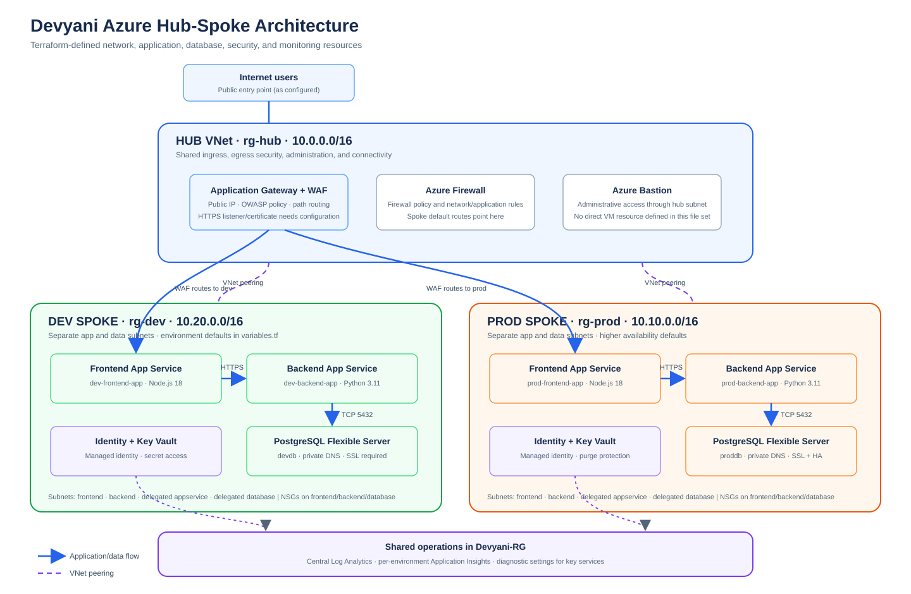
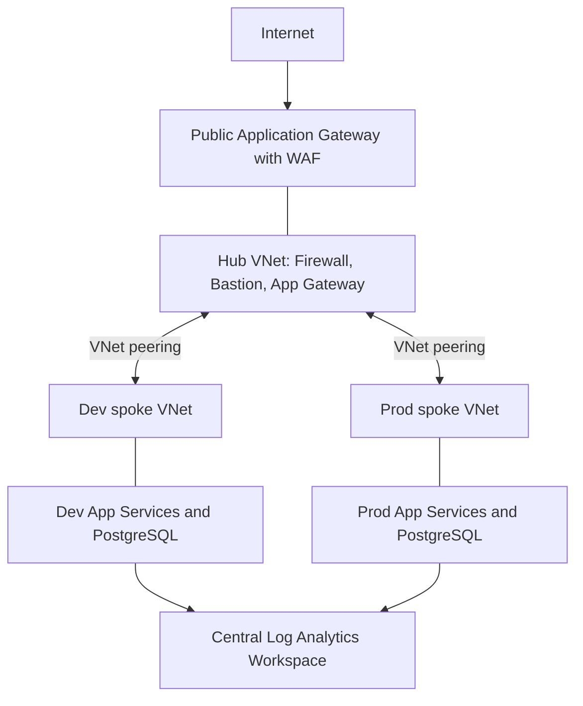
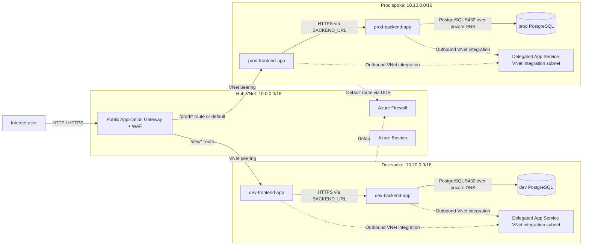
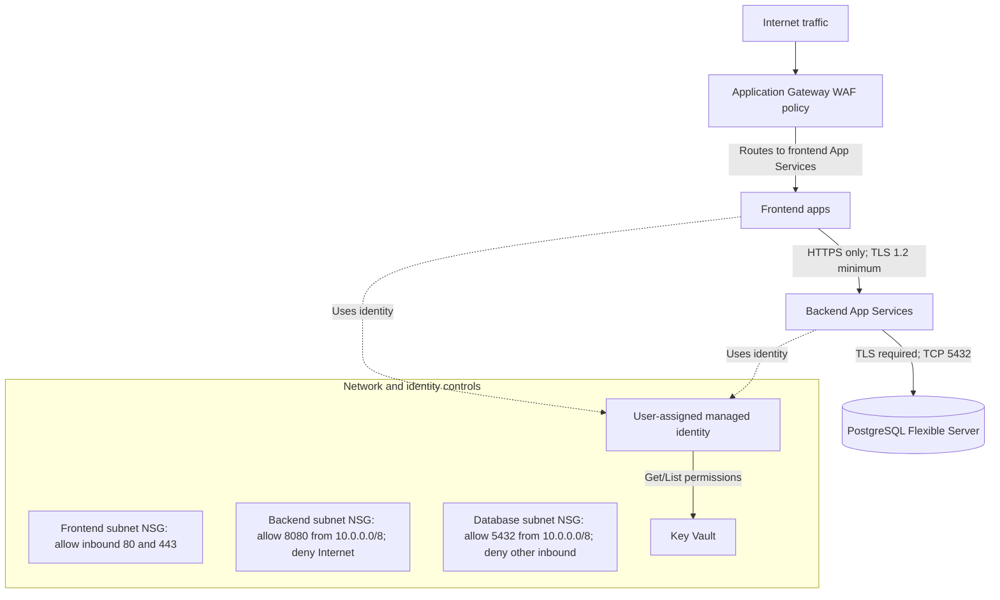
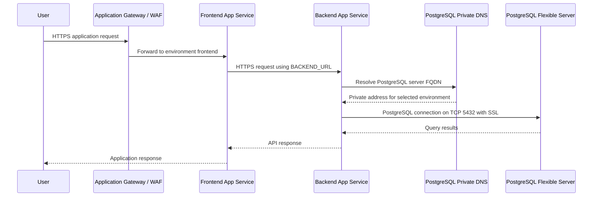
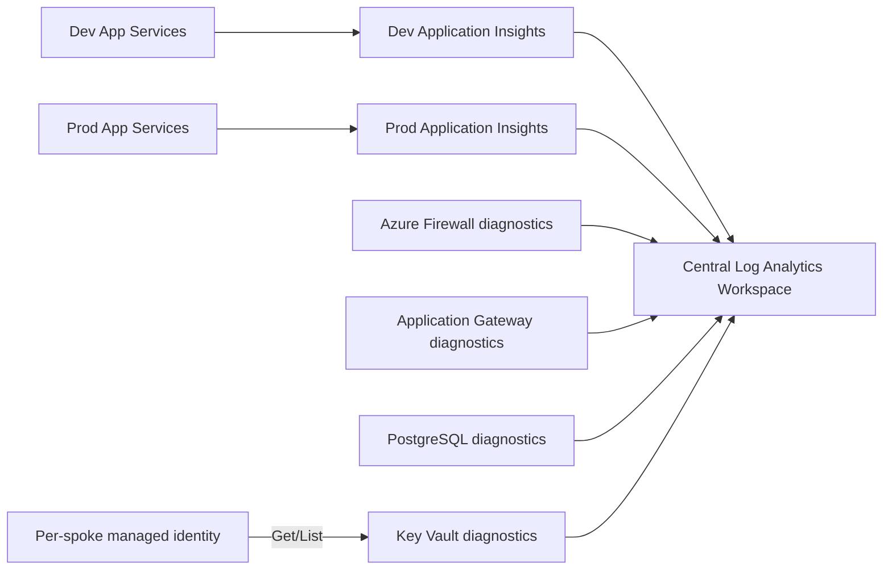

# Devyani Hub-Spoke Azure Infrastructure

This Terraform project defines an Azure Hub-Spoke network architecture and a Platform-as-a-Service (PaaS) workload setup. It references existing hub and spoke networking and deploys new Azure services into a resource group named `Devyani-RG`.

## Project Overview

The main objectives of this project are:

- Provide shared security and connectivity services in the hub network
- Create separate spoke VNets for each environment (`dev` and `prod`)
- Isolate frontend, backend, and database workloads using separate subnets and NSGs
- Configure VNet integration and private connectivity for App Services and PostgreSQL
- Integrate monitoring, logging, identity, and secret management capabilities

## Architecture Summary

### Visual Architecture Design



The diagram is also available as a standalone file: [architecture.svg](architecture.svg).

### High-Level Diagram



### 1. Network and Request Flow



### 2. Security Flow



The NSGs are associated with the frontend, backend, and database subnets. App Services have public network access enabled and use the delegated appservice subnet for outbound VNet integration; this does not by itself make their inbound traffic private. As configured, users may be able to reach an App Service directly and bypass the WAF unless App Service access restrictions are added. Review route-table associations and effective routes before deployment, especially for delegated subnets.

### 3. Application-to-Database Flow



The `dev` and `prod` servers use the same private DNS zone linked to the hub and both spoke VNets; each backend is configured with its corresponding server FQDN and database name.

### 4. Monitoring and Secrets Flow



**Configuration note:** The Terraform defines an HTTP listener and a redirect targeting `listener-https`, but the Application Gateway configuration currently does not define that HTTPS listener or its certificate. Add and configure the HTTPS listener before expecting the HTTPS routing flow shown above to work.

### Layered View

```text
Hub VNet (rg-hub)
├── Azure Firewall
├── Azure Bastion
├── Application Gateway / WAF
└── Route tables + peering

Spoke VNet: dev (rg-dev)
├── frontend subnet
├── backend subnet
├── database subnet
├── appservice subnet
├── NSGs
├── App Service Plan
├── Linux Web App (frontend)
├── Linux Web App (backend)
├── PostgreSQL Flexible Server
└── Private DNS Zone for PostgreSQL

Spoke VNet: prod (rg-prod)
├── frontend subnet
├── backend subnet
├── database subnet
├── appservice subnet
├── NSGs
├── App Service Plan
├── Linux Web App (frontend)
├── Linux Web App (backend)
├── PostgreSQL Flexible Server
└── Private DNS Zone for PostgreSQL

Devyani-RG (new resources)
├── Log Analytics Workspace
├── Managed Identities
├── Key Vaults (per spoke)
├── App Insights (per spoke)
├── Diagnostic settings for services
└── App Service + PostgreSQL resources
```

## Files

### 1) `main.tf`
This file defines the base networking and peering:

- Hub resource group and spoke resource groups
- Hub VNet and spoke VNets
- Subnet creation
- App Service delegation on the appservice subnet
- PostgreSQL delegation on the database subnet
- VNet peering between hub and spokes

### 2) `hub_services.tf`
This file defines shared hub-level services:

- Azure Firewall
- Firewall policy and rules
- Public IPs
- Route tables for spokes
- Azure Bastion
- Application Gateway with WAF
- Network rules for internal traffic, DNS, and PostgreSQL access

### 3) `spoke_paas.tf`
This file defines platform and database resources:

- NSGs for frontend, backend, and database subnet tiers
- NSG associations with subnets
- App Service Plan per environment
- Linux Web Apps for frontend and backend
- User-assigned managed identity
- Private DNS zone for PostgreSQL
- PostgreSQL Flexible Server per environment
- Database creation and secure transport enforcement

### 4) `observability.tf`
This file covers monitoring and security controls:

- Log Analytics Workspace
- Application Insights per spoke
- Key Vault per spoke
- Managed identity creation
- Diagnostic settings for Firewall, App Gateway, App Services, PostgreSQL, and Key Vault

### 5) `variables.tf`
All configurable inputs for the project are defined here:

- Region (`location`)
- Hub and spoke network configuration
- App runtime settings
- Azure PostgreSQL settings
- Firewall, Bastion, and App Gateway configuration
- Tags
- Log Analytics and Key Vault configuration

### 6) `providers.tf`
Defines the Terraform providers and the required Terraform version.

### 7) `outputs.tf`
Returns important values after deployment, such as public/private endpoints, names, and IDs.

### 8) `terraform.tfvars`
Contains environment-specific values such as subnet CIDRs and PostgreSQL settings.

## Main Resources Created

### Network
- Hub VNet
- Spoke VNets (`dev` and `prod`)
- Subnets
- NSGs
- VNet peering
- Route tables

### Security
- Azure Firewall
- Application Gateway WAF
- Azure Bastion
- NSGs and private access rules

### Application Platform
- App Service Plan (Linux)
- Linux Web Apps for frontend and backend
- Managed identity for each spoke

### Data Platform
- Azure Database for PostgreSQL Flexible Server
- Private DNS zone for PostgreSQL
- SSL enforcement configuration

### Observability / Operations
- Log Analytics Workspace
- Application Insights
- Diagnostic settings for critical services
- Key Vault for secret management

## Environment Configuration

The project defaults include:

- Location: `East US`
- Hub VNet: `10.0.0.0/16`
- Dev Spoke: `10.20.0.0/16`
- Prod Spoke: `10.10.0.0/16`
- App runtime:
  - Frontend: `NODE|18-lts`
  - Backend: `PYTHON|3.11`

## PostgreSQL Defaults

Default PostgreSQL settings:

- Dev DB: `devdb`
- Prod DB: `proddb`
- Postgres admin user: `pgadmin`
- Dev SKU: `B_Standard_B1ms`
- Prod SKU: `GP_Standard_D2s_v3`

## Deployment Steps

1. Sign in to Azure:

```bash
az login
```

2. Initialize Terraform:

```bash
terraform init
```

3. Validate the configuration:

```bash
terraform validate
```

4. Review the deployment plan:

```bash
terraform plan
```

5. Apply the infrastructure:

```bash
terraform apply
```

## Notes / Important Considerations

- `Devyani-RG` is treated as an existing resource group. Before deployment, it is important to either import the existing state or ensure it matches the current Azure infrastructure.
- Some resources are intentionally configured to match existing Terraform state and are not recreated automatically.
- App Service VNet integration and route table association on the database subnet must be carefully managed, because incorrect UDRs can break App Service connectivity or PostgreSQL delegation.
- Key Vault and PostgreSQL credentials should follow secure storage patterns in production.
- `postgres_admin_password` and other secrets should not be stored directly in source control; use proper secret management.

## Use Case / Business Purpose

This design functions as a standard enterprise Azure landing zone where:

- secure multi-environment deployments are supported
- internet-facing frontend applications can be exposed behind WAF and public access controls
- internal backend and database services stay isolated within private networking
- Azure-native logging, identity, and secret management are integrated out of the box

## Recommended Next Enhancements

- Add private endpoints for Key Vault and App Service for stricter network isolation
- Integrate Azure Front Door / CDN for global routing
- Enforce Azure Policy baselines
- Set up CI/CD pipelines for application deployment
- Add more granular RBAC for identities

## Conclusion

This Terraform code provides an enterprise-ready Azure Hub-Spoke architecture with secure network segmentation, PaaS app hosting, private database connectivity, observability, and identity controls. The main goal is to deploy `dev` and `prod` environments securely, scalably, and maintainably using native Azure services.
